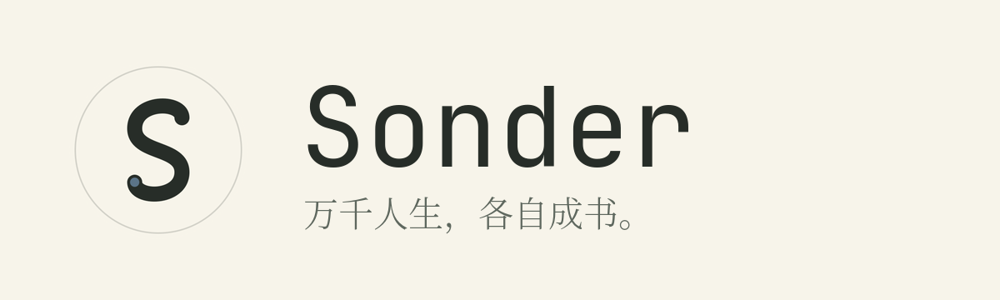
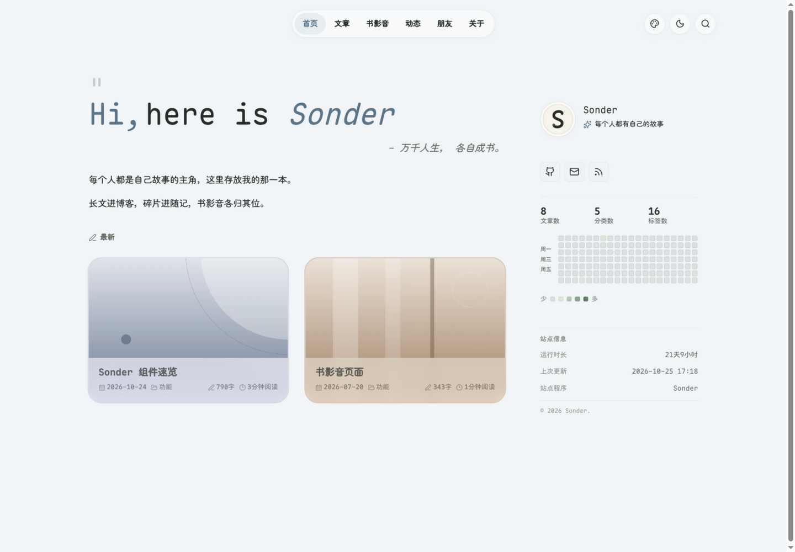

<p align="center">
  
</p>

<p align="center">Every life is a book.</p>

<p align="center">
  <a href="https://sonder.liang.one">Live site</a> ·
  <a href="https://github.com/lmb666666/Sonder">GitHub</a>
</p>



Sonder is a paper-like personal publishing template built with Astro and Bun. It brings articles, media, moments, friends, and profile information into one calm layout for long-term writing and independent publishing.

## Features

- Paper-inspired visual language: warm paper, ink text, hairlines, muted palettes
- Article cards with 16:9 covers, frosted meta bands, categories, tags, TOC, related posts
- Dark mode: cover-tinted glass bands and matching dark rings
- Homepage: profile, stats, writing heatmap, site info, latest posts
- Pages: media shelf, moments timeline, friends and friend circle
- Navigation: pill or bar layout, selectable in `site.toml`
- Search: Pagefind static full-text index with `Ctrl+K` / `Cmd+K`
- Comments: giscus, utterances, Waline, Twikoo, or disabled
- Static output: RSS, Atom, sitemap, and a GitHub Pages workflow

## Quick start

Requires Node.js 22.12+ and Bun.

```bash
git clone https://github.com/lmb666666/Sonder.git
cd Sonder
bun install
bun run dev
```

The dev server runs at `http://localhost:4321`.

## Configuration

Site-level settings live in `src/config/site.toml`:

- `[config.site]`: title, description, URL, repository, footer note
- `[config.profile]`: author name, role, avatar, email, website, GitHub
- `[config.siteInfo]`: site info card; `program` also drives the footer credit
- `[[config.topNav.links]]`: top navigation
- `[config.theme]`: default palette, language, and `navStyle` (`pill` / `bar`)
- `[config.pages]`: page titles, kickers, and subtitles
- `[config.home]`: quote, intro, latest post count, contact links
- `[config.search]`, `[config.comments]`, `[config.friendCircle]`: search, comments, friend circle

The config shape is validated by the Zod schema in `src/content.config.ts`. Page modules are registered in `sonder.config.ts`; the media module is enabled by default.

## Content

```text
src/content/
  about.mdx        About page
  blog/            Articles and guides
  media/           Books, films, music
  projects/        Project cards on the About page
```

Demo articles, media entries, and project cards can be edited or removed. Article covers live in `src/assets/figure/covers/` and can be replaced with your own images.

## Commands

```bash
bun run dev          # local dev server
bun run build        # static build + Pagefind index
bun run preview      # preview the build
bun run post:new     # new article
bun run media:new    # new media entry
bun run format:check # formatting check
bun run lint         # ESLint
bun test             # unit tests
```

## Deployment

The build output is in `dist/` and can be deployed to GitHub Pages, Vercel, Netlify, Cloudflare Pages, or any static host. The included GitHub Pages workflow builds on pushes to `main` or `sonder`.

For a subpath deployment:

```bash
SITE_URL=https://example.com SITE_BASE=/my-site bun run build
```

## Project layout

```text
src/
  components/       page components, cards, blog tools, home widgets
  config/site.toml  site configuration
  content/          about, blog, media, projects
  layouts/          base and article layouts
  pages/            Astro routes
  i18n/             English, Simplified Chinese, Traditional Chinese UI text
  data/             friends, moments, config helpers
sonder.config.ts    page module and plugin registration
```

## Credits & License

Sonder is an independent template derived from Navfolio, which is MIT licensed. The original copyright notices are preserved in the root `LICENSE` and the vendored packages' `LICENSE` files.

Sonder is released under the MIT license.
