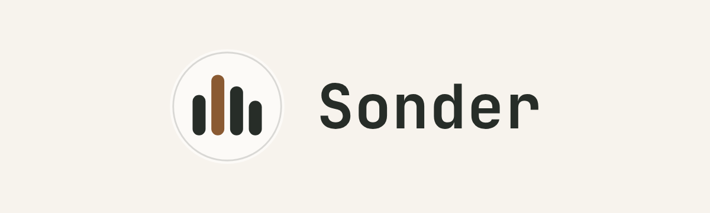

<p align="center">
  
</p>

<p align="center">
  以纸面阅读感为核心的个人发布模板 · Astro 静态构建
</p>

<p align="center">
  <a href="https://sonder.liang.one">在线预览</a> ·
  <a href="https://sonder.liang.one/blog/get-start/">使用指南</a> ·
  <a href="./CONTRIBUTING.md">参与贡献</a> ·
  <a href="./README.en.md">English</a>
</p>

<p align="center">
  
  
  
  
  
</p>


Sonder 是一份以纸面阅读感为核心的个人发布模板：暖白纸底、墨色文字、发丝分隔线，把文章、书影音、动态和朋友页收进同一套版式。基于 Astro 静态构建，内容用 Markdown / MDX 管理，没有后端依赖。

## ✨ 特性

**内容与版式**

- **双布局文章列表** —— `media` 媒体大图与 `rows` 行式列表，配置切换
- **书影音 / 动态 / 朋友页** —— 媒体架、时间线、友链朋友圈开箱即用
- **8 套色盘 + 深色模式** —— 默认暖橙，可整体换色
- **三档导航** —— `pill` 胶囊 / `bar` 通栏 / `legacy` 旧版通栏

**阅读体验**

- **目录与移动端浮层目录** —— 长文导航，移动端右下角悬浮展开
- **上下篇与更多文章** —— 文章底部自动生成导航卡片
- **分享海报** —— 一键生成带二维码的分享图，或复制带链接的文案
- **全文搜索** —— Pagefind 静态索引，`Ctrl+K` / `Cmd+K` 唤起

**站点能力**

- **评论** —— giscus / utterances / Waline / Twikoo，可关闭
- **数学公式与图表** —— KaTeX / MathJax、Mermaid、ABC 乐谱
- **外挂标签** —— `:::note` / `:badge` / `::github` 等指令零 import 直写，覆盖提醒块、标签页、媒体、音乐、友链等 20+ 组件
- **静态输出** —— RSS、Atom、sitemap、llms.txt；构建生成按需字体子集

## 🚀 快速开始

环境要求：Node.js 22.12+、Bun；首次构建另需 Python 3 与 fonttools / brotli（用于字体子集）。

```bash
git clone https://github.com/lmb666666/Sonder.git
cd Sonder
bun install
bun run dev
```

开发服务器默认运行在 `http://localhost:4321`。正式构建前补齐字体工具链：

```bash
python3 -m venv .venv
.venv/bin/python -m pip install fonttools brotli
bun run build
```

写第一篇文章用 `bun run post:new my-post`，frontmatter 常用字段：

```yaml
title: 我的第一篇文章
description: 一句话摘要，会出现在列表与分享卡上。
date: 2026-10-31
tags: [随笔]
categories: [生活]
heroImage: '/src/assets/figure/covers/cover-01-sage.png'
```

## 📖 使用指南

完整的配置与写作文档直接读演示站上的指南，与模板一同发布、始终同步：

| 指南                                                                 | 内容                             |
| -------------------------------------------------------------------- | -------------------------------- |
| [快速开始](https://sonder.liang.one/blog/get-start/)                 | 替换站点信息、写文章、构建与部署 |
| [站点配置](https://sonder.liang.one/blog/site-config-guide/)         | `site.toml` 全部字段说明         |
| [主题与色盘](https://sonder.liang.one/blog/theme-palettes/)          | 8 套色盘与深色模式               |
| [组件速览](https://sonder.liang.one/blog/components-showcase/)       | 全部外挂标签的语法与真实演示     |
| [Markdown 风格](https://sonder.liang.one/blog/markdown-style-guide/) | 排版规范与扩展语法               |
| [站内搜索](https://sonder.liang.one/blog/site-search-guide/)         | Pagefind 配置                    |
| [书影音页面](https://sonder.liang.one/blog/media-page-guide/)        | 条目格式与媒体架                 |
| [友链与朋友圈](https://sonder.liang.one/blog/friend-links-guide/)    | 友链、朋友圈与申请表单           |

## ☁️ 部署

构建产物在 `dist/`，可部署到 GitHub Pages、Vercel、Netlify、Cloudflare Pages 等任意静态托管。子路径部署：

```bash
SITE_URL=https://example.com SITE_BASE=/my-site bun run build
```

## 🛠 常用命令

```bash
bun run dev           # 本地开发
bun run build         # 构建（含字体子集）+ Pagefind 索引
bun run preview       # 预览构建产物
bun run post:new      # 新建文章
bun run media:new     # 新建书影音条目
bun run format:check  # 格式检查（ESLint + Prettier）
bun test              # 单元测试
```

## 🤝 参与贡献

欢迎 Issue 与 PR。提交前请阅读 [CONTRIBUTING.md](./CONTRIBUTING.md)：跑通 `format:check`、`bun test` 与 `bun run build`，并保持现有视觉语言。

## 🙏 致谢与许可

Sonder 基于 [Navfolio](https://github.com/dodolalorc/astro-navfolio) 二次开发，由 Liang 维护；分享海报参考了 [Firefly](https://github.com/CuteLeaf/Firefly)。相关版权声明统一保留在 [LICENSE](./LICENSE) 中，本项目以 MIT 许可发布。
