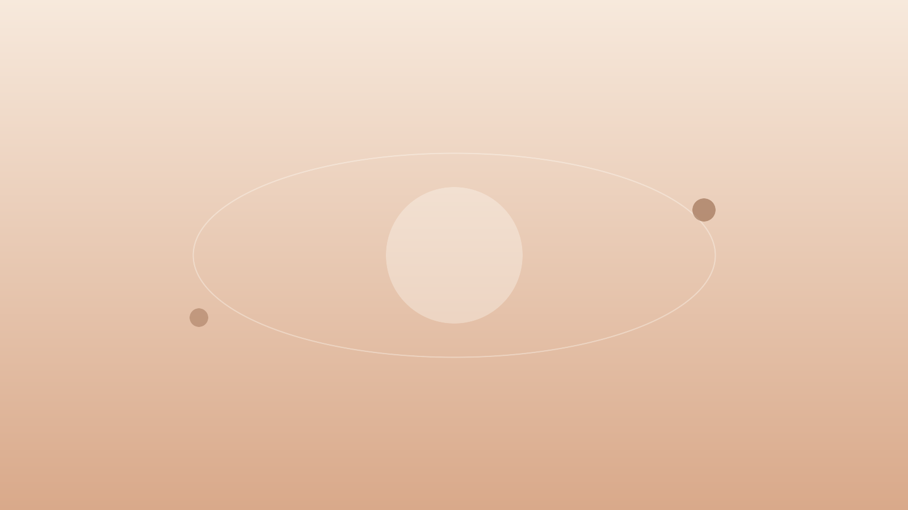
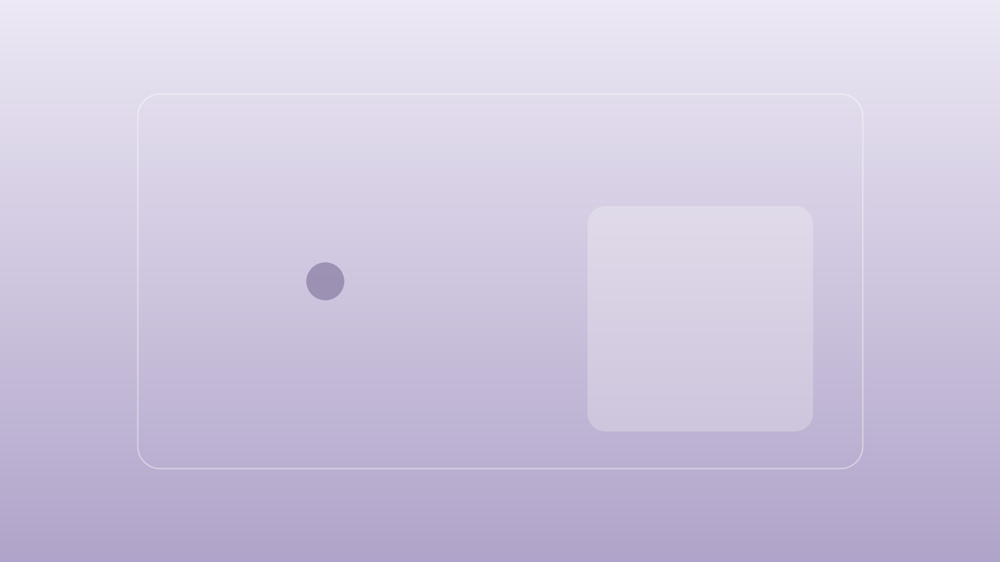

Sonder 提供一套**外挂标签**语法：写作时直接写指令，构建期渲染成组件，零 import，直接写在 `.md` 里。标准 Markdown 语法见 [Markdown 语法](/blog/markdown-style-guide/)，本文只讲模板扩展的组件能力。

## 语法速查

外挂标签有三种形式，均为 `名称 + [标题] + {属性}` 的组合：

- **容器** `:::name[标题]{属性}` … `:::`：包裹一段内容（提醒块、标签页、诗歌……）
- **叶子** `::name{属性}`：自闭合块（链接卡、视频、播放器……）
- **行内** `:name[文字]{属性}`：混排行内文字（徽标、按键、剧透……）

| 容器指令 | 说明 |
| --- | --- |
| `note` / `tip` / `warning` / `danger` … | 提醒块，30+ 类型别名，`{foldable}` 折叠、`{open}` 默认展开 |
| `details` | 折叠面板，需要 `[标题]`，`{open}` 默认展开 |
| `grid` | 图片网格 |
| `tabs` + `tab` | 标签页；外层围栏比内层多一道冒号 |
| `columns` + `column` | 分栏；`{cols="2" ratio="1:2"}` |
| `timeline` + `event` | 时间线；`{direction="horizontal"}`，`:::event[日期]` |
| `poetry` | 诗歌排版；`[标题\|作者]`，`{footer="…"}` |
| `chat` | 聊天记录；`{名字}` / `{.我}` / `{:系统}` |
| `cards` | 卡片列表，包裹 Markdown 列表 |
| `carousel` | 轮播；`{aspect="16 / 9"}` |
| `long-image` | 长图滚动视口；`{height="320px" caption="…"}` |
| `media-shelf` + `media-item` | 媒体架；`{columns="4"}`，子项 `{type="book" title="…" creator="…" rating="4"}` |
| `music-score` | ABC 记谱法乐谱；乐谱源码写在围栏代码块内 |

| 叶子指令 | 说明 |
| --- | --- |
| `link-card` | 链接卡片；`{href="…" title="…" description="…" icon="…"}` |
| `github-card` | GitHub 仓库卡片；`{repo="owner/repo"}`，stars 构建期预取 |
| `bilibili` | B 站视频；`{bvid="BV…"}`，`{nano}` 小窗播放器 |
| `youtube` | YouTube 视频；`{id="…"}` |
| `music` | 音乐平台曲目；`{url="…"}` 自动识别网易云/QQ/Spotify 等，或 `{provider="…" url="…"}`、`{server="netease\|tencent" type="…" id="…"}`；Meting 优先，官方 embed 兜底 |
| `audio` | 本地/直链音频；`{src="…" title="…" artist="…" artwork="…"}` |
| `video` | 本地/直链视频；`{src="…" poster="…" ratio="…"}` |
| `douyin` | 抖音视频；`{vid="…"}`，`{wide}` 横屏 |
| `tiktok` | TikTok 视频；`{id="…"}` |
| `friend-link-card` | 友链卡片网格；`{src="demo"\|"youlin" columns="3"}` |
| `friend-circle` | 朋友圈动态；`{src="demo"\|"youlin" limit="10" title="…"}` |
| `friend-link-application` | 友链申请表单；`{repository="owner/repo"}`；可用 `provider="github"\|"youlin"` 覆盖全局申请入口 |

配置 `[config.youlin]` 后，`src="youlin"` 会读取友邻接口；未配置或接口不可用时回退内置演示数据。

| 行内指令 | 说明 |
| --- | --- |
| `badge` | 行内徽标；`{href="…"}` 可点击，`{img="…"}` 带图标，`{square}` 取消圆角 |
| `key` | 键帽；支持 `{ctrl}` `{shift}` `{cmd}` 等修饰键，真实按键时点亮 |
| `spoiler` | 剧透模糊，悬停或聚焦显形；点击/回车切换（适配触屏） |
| `span` | 行内样式；`{color="#…"}`，`.类名` 可挂自定义 class |
| `btn` | 行内按钮；`{href="…"}` |

规则：**嵌套**时外层围栏冒号数必须多于内层（`::::tabs` 包 `:::tab`）；`{a=b}` 与 `{a="b"}` 等价，`#id`、`.class` 简写可用；未知指令展开为普通内容并在构建时警告；演示语法本身时放进代码围栏即可。

---

## 行内组件

### Badge 徽标

带图标与链接的行内徽标；不传 `img` 时会自动取 GitHub 头像或站点 favicon。

```md
:badge[Astro]{href="https://astro.build"}
:badge[纯文字徽标]
:badge[带图圆形]{img="https://github.com/lmb666666.png?size=64" href="https://github.com/lmb666666"}
:badge[带图方形]{img="https://github.com/lmb666666.png?size=64" square}
```

:badge[Astro]{href="https://astro.build"}
:badge[GitHub]{href="https://github.com/lmb666666/Sonder"}
:badge[纯文字徽标]
:badge[带图圆形]{img="https://github.com/lmb666666.png?size=64" href="https://github.com/lmb666666"}
:badge[带图方形]{img="https://github.com/lmb666666.png?size=64" square}

### Key 按键

快捷键键帽；macOS 上自动切换符号，页面上真实按下对应组合键时按键会点亮。

```md
复制 :key[Ctrl] + :key[C]
搜索 :key[Cmd] + :key[K]{cmd}
```

复制 :key[Ctrl] + :key[C]；搜索 :key[Cmd] + :key[K]{cmd}；全选 :key[Ctrl] + :key[Shift] + :key[A]

### 剧透 spoiler

```md
剧透警告：:spoiler[他是凶手]
```

默认模糊，悬停或聚焦显形；点击、回车可切换显隐（触屏没有 hover 也能用）——剧透警告：:spoiler[他是凶手]。

### Span 彩色文字

```md
:span[一抹赭石色]{color="#8a5a32"}
```

把重点写成 :span[一抹赭石色]{color="#8a5a32"}，或 :span[主题色强调]{color="var(--paper-accent)"}。

也可以用 `.类名` 挂站点自定义 CSS 中的类名，实现自定义配色与样式。

### Btn 按钮与 Btns 按钮组

```md
:btn[查看仓库]{href="https://github.com/lmb666666/Sonder"}
```

:btn[查看仓库]{href="https://github.com/lmb666666/Sonder"}

多个 `:btn` 放进 `:::btns` 即成按钮组；`{layout}` 控制排版：

| layout | 效果 |
| --- | --- |
| `flex`（默认） | 流式横排，自动换行 |
| `wide` | 整行竖排、撑满宽度 |
| `fill` | 等宽填满一行 |
| `grid-2` / `grid-3` / `grid-4` | 网格排列，窄屏自动降为两列 |

```md
::::btns{layout="grid-2"}
:btn[GitHub 仓库]{href="https://github.com/lmb666666/Sonder"}
:btn[组件速览]{href="/blog/components-showcase/"}
:btn[Astro]{href="https://astro.build"}
:btn[Pagefind]{href="https://pagefind.app"}
::::
```

::::btns{layout="grid-2"}
:btn[GitHub 仓库]{href="https://github.com/lmb666666/Sonder"}
:btn[组件速览]{href="/blog/components-showcase/"}
:btn[Astro]{href="https://astro.build"}
:btn[Pagefind]{href="https://pagefind.app"}
::::

`wide` 布局适合下载区/行动号召：

```md
::::btns{layout="wide"}
:btn[下载最新版]{href="https://github.com/lmb666666/Sonder/releases"}
:btn[查看源码]{href="https://github.com/lmb666666/Sonder"}
::::
```

::::btns{layout="wide"}
:btn[下载最新版]{href="https://github.com/lmb666666/Sonder/releases"}
:btn[查看源码]{href="https://github.com/lmb666666/Sonder"}
::::

> 注意：按钮组里每行写一个 `:btn`；网格布局在窄屏自动降为两列，无需写响应式样式。

## 提醒块与结构

### Callout 提醒块

`:::note` 家族与标准引用块写法相近；`{foldable}` 可折叠，`{open}` 默认展开。共 27 个类型别名，全部同义换肤：

- **信息类**：`note`、`info`、`abstract`、`summary`、`tldr`、`tip`、`hint`、`important`、`check`、`success`、`done`、`question`、`faq`、`help`
- **警示类**：`warning`、`caution`、`attention`、`danger`、`error`、`fail`、`failure`、`missing`、`bug`
- **引用类**：`quote`、`cite`

```md
:::note[自定义标题]
在围栏后加 `{foldable}` 即可折叠。
:::

:::danger
部署前记得备份。
:::
```

:::note[自定义标题]
在围栏后加 `{foldable}` 即可折叠。
:::

:::danger
部署前记得备份。
:::

:::info
这里是补充信息。
:::

:::success
操作已成功完成。
:::

:::quote
引用类提醒块保留引用语义。
:::

### Details 折叠面板

```md
:::details[点我展开]{open}
默认展开的折叠面板。
:::
```

:::details[点我展开]{open}
默认展开的折叠面板。
:::

### Grid 图片网格

```md
:::grid


:::
```

:::grid


:::

### Tabs 标签页

```md
::::tabs
:::tab[前端]
前端内容。
:::
:::tab[后端]
后端内容。
:::
::::
```

::::tabs
:::tab[前端]
前端内容：Astro 静态生成，岛架构按需注水。
:::
:::tab[后端]
后端内容：纯静态输出，评论与动态走外部服务。
:::
:::tab[写作]
写作内容：Markdown 里写指令即可。
:::
::::

### Columns 分栏

```md
::::columns{cols="2"}
:::column
左栏内容。
:::
:::column
右栏内容。
:::
::::
```

::::columns{cols="2" ratio="1:2"}
:::column
左栏（1/3）：`{ratio="1:2"}` 控制各栏宽度比。
:::
:::column
右栏（2/3）：分栏在窄屏自动折叠为单列；含图栏可配 `{mobile="media-first"}` 在窄屏排最前。
:::
::::

### Timeline 时间线

```md
::::timeline
:::event[2026-10-25]
发布外挂标签体系。
:::
:::event[2026-10-31]
全组件指令化。
:::
::::
```

::::timeline
:::event[2026-10-25]
统一指令语法落地。
:::
:::event[2026-10-31]
全部组件指令化，文章回归纯 Markdown。
:::
::::

`{direction="horizontal"}` 切换横向时间线（可横向滑动）：

```md
::::timeline{direction="horizontal"}
:::event[第一季度]
设计与重构。
:::
:::event[第二季度]
外挂标签体系。
:::
::::
```

::::timeline{direction="horizontal"}
:::event[第一季度]
设计与重构。
:::
:::event[第二季度]
外挂标签体系。
:::
:::event[第三季度]
内容与文档。
:::
::::

## 排版组件

### Poetry 诗歌排版

标签写 `[标题|作者]`，脚注用 `{footer}`。

```md
:::poetry[俳句一则|示例]{footer="—— 匿名"}
旧博客沉去
新模板在纸上醒来
秋夜灯正明
:::
```

:::poetry[俳句一则|示例]{footer="—— 匿名"}
旧博客沉去
新模板在纸上醒来
秋夜灯正明
:::

### Chat 聊天记录

`{名字}` 为对方消息、`{.我}` 为我方消息（靠右、主题色）、`{:文字}` 为系统消息（居中小字）；署名行与消息行之间建议空行。

```md
:::chat
{.我}

博客重写用什么模板？

{朋友}

Sonder 收编完成，组件和内容都对齐了。

{:对方撤回了一条消息并投来羡慕的目光}
:::
```

:::chat
{.我}

博客重写用什么模板？

{朋友}

Sonder 收编完成，组件和内容都对齐了。

{:对方撤回了一条消息并投来羡慕的目光}

{.我}

那就这么定了。
:::

### CardList 卡片列表

把 Markdown 列表渲染为响应式卡片网格。

```md
:::cards
- Astro 静态生成
- Pagefind 中文搜索
:::
```

:::cards

- Astro 静态生成
- Pagefind 中文搜索
- Twikoo 评论
- abcjs 乐谱

:::

## 图像与媒体

### Carousel 轮播

容器里的每个顶层元素是一张幻灯片，左右按钮切换；`{aspect}` 控制画幅（如 `16 / 9`、`4 / 3`）。

```md
:::carousel{label="封面轮播" aspect="16 / 9"}


:::
```

:::carousel{label="封面轮播" aspect="16 / 9"}


:::

### LongImage 长图

长图放在固定高度的可滚动视口中，适合截图、长表格或纵向信息图；`{height}` 控制视口高度，`{caption}` 为底部说明。

```md
:::long-image{height="240px" caption="在视口内滚动查看完整图片。"}

:::
```

:::long-image{height="240px" caption="在视口内滚动查看完整图片；按 Tab 聚焦后也可以使用键盘滚动。"}

:::

### 图片放大（全局行为）

文章里的块级图片默认可点击放大（PhotoSwipe 灯箱，移动端支持捏合缩放），无需任何指令；
与文字混排的行内小图、链接内的图片不参与放大：


### MediaShelf 媒体架

书、电影、剧集、专辑和播客共用一套货架；封面跟随图片处理管线。

> 注意：封面写在 `:::media-item` 内的图片段落（本地相对路径或外链均可），标题、作者与评分用子指令属性书写；`{columns}` 支持 2~5。

```md
::::media-shelf{columns="4"}
:::media-item{type="book" title="Sonder 手记" creator="示例作者" rating="4" cover-aspect="portrait"}

:::
::::
```

::::media-shelf{columns="4"}
:::media-item{type="book" title="Sonder 手记" creator="示例作者" rating="4" cover-aspect="portrait"}

:::
:::media-item{type="film" title="夜航" creator="示例导演" rating="5" cover-aspect="portrait"}

:::
:::media-item{type="album" title="缓慢的下午" creator="示例音乐人" rating="4" cover-aspect="portrait"}

:::
:::media-item{type="podcast" title="城市观察" creator="示例播客" cover-aspect="portrait"}

:::
::::

### Mermaid 图表

文章布局已全局挂载 Mermaid 渲染器，正文里直接写 `mermaid` 代码块即可：

````md

````


## 链接与社群

### 链接卡片 link-card

```md
::link-card{href="https://github.com/lmb666666/Sonder" title="Sonder" description="以纸面阅读感为核心的个人发布模板" icon="https://github.com/lmb666666.png?size=64"}
```

::link-card{href="https://github.com/lmb666666/Sonder" title="Sonder" description="以纸面阅读感为核心的个人发布模板" icon="https://github.com/lmb666666.png?size=64"}

### GitHub 仓库卡片 github-card

仓库描述与 stars 在构建期预取（脚本 `bun run github-cards`），离线时降级为普通链接卡。

```md
::github-card{repo="CuteLeaf/Firefly"}
```

::github-card{repo="CuteLeaf/Firefly"}

### Bilibili / YouTube 视频

```md
::bilibili{bvid="BV1GJ411x7h7"}
::bilibili{bvid="BV1GJ411x7h7" nano}
::youtube{id="dQw4w9WgXcQ"}
```

`{nano}` 切换 B 站小窗播放器（无弹幕与推荐模块）。YouTube 在部分网络环境无法加载，属预期行为。

::bilibili{bvid="BV1GJ411x7h7"}

::youtube{id="dQw4w9WgXcQ"}

### Video / Douyin / TikTok 视频

本地或直链视频文件用 `::video`（支持 `poster` 封面与 `ratio` 画幅）；抖音用 `::douyin`（`{wide}` 切横屏播放器，竖屏默认 `27/56` 画幅并自动做宽度补偿）；TikTok 用 `::tiktok`：

```md
::video{src="https://interactive-examples.mdn.mozilla.net/media/cc0-videos/flower.mp4" poster="…"}
::douyin{vid="抖音视频ID"}
::douyin{vid="…" wide}
::tiktok{id="TikTok视频ID"}
```

::video{src="https://interactive-examples.mdn.mozilla.net/media/cc0-videos/flower.mp4"}

> 注意：抖音与 TikTok 的视频 ID 各自独立、互不通用；示例从略——没有有效 ID 时播放器会显示平台错误，反而干扰阅读。

### FriendLinkCard 友链卡片

友链以卡片网格排列；`src` 指向 `src/data/` 里配置的数据源。

```md
::friend-link-card{src="demo" columns="3"}
```

::friend-link-card{src="demo" columns="3"}

不建数据源、只想在文章里放一两个站点时，直接写属性即可：

```md
::friend-link-card{name="Sonder" url="https://sonder.liang.one" avatar="https://github.com/lmb666666.png?size=64" bio="以纸面阅读感为核心的个人发布模板"}
```

::friend-link-card{name="Sonder" url="https://sonder.liang.one" avatar="https://github.com/lmb666666.png?size=64" bio="以纸面阅读感为核心的个人发布模板"}

### FriendCircle 朋友圈

把友链的 RSS/Atom 动态聚合成时间线，右上角按钮可以重新洗牌；下面使用内置演示数据，不依赖外部订阅源。

```md
::friend-circle{src="demo" limit="3" title="朋友动态"}
```

::friend-circle{src="demo" limit="3" title="朋友动态"}

### FriendLinkApplication 友链申请

填写名称、主页、简介、头像和 RSS，实时生成友链 JSON；可以复制，也可以直接打开 GitHub Issue 申请。

```md
::friend-link-application{repository="https://github.com/lmb666666/Sonder"}
```

::friend-link-application{repository="https://github.com/lmb666666/Sonder" title="申请友链" appearance="bordered"}

## 音乐与乐谱

### 本地音频 `audio`

本地文件或直链音频走原生 `<audio>` 播放器；音频放在 `public/` 下，用 `/...` 路径引用：

| 属性 | 说明 |
| --- | --- |
| `src` | 音频直链（播客、录音、自制曲目） |
| `title` / `artist` / `artwork` | 播放器标题、作者、封面 |
| `caption` | 播放器底部说明 |

```md
::audio{title="示例音频" artist="SoundHelix" src="https://www.soundhelix.com/examples/mp3/SoundHelix-Song-1.mp3"}
```

::audio{title="示例音频" artist="SoundHelix" src="https://www.soundhelix.com/examples/mp3/SoundHelix-Song-1.mp3"}

### 音乐平台 `music`

`music` 统一处理音乐平台链接：网易云与 QQ 走 Meting，Spotify / SoundCloud / Apple Music / Bandcamp 走官方 embed。网易云音频可用时渲染原生播放器；QQ 在当前公共 Meting 实例上只有元数据，渲染曲目卡片；解析失败时降级为链接卡片。

```md
::music{url="https://music.163.com/#/playlist?id=7294439968"}
::music{url="https://music.163.com/song?id=28560087"}
::music{url="https://open.spotify.com/track/4cOdK2wGLETKBW3PvgPWqT"}
```

::music{url="https://music.163.com/#/playlist?id=7294439968"}

::music{url="https://music.163.com/song?id=28560087"}

::music{title="示例曲目" provider="spotify" url="https://open.spotify.com/track/4cOdK2wGLETKBW3PvgPWqT"}

也可显式写 `{server="netease|tencent" type="song|playlist|album" id="…"}`；YouTube 视频请使用 `::youtube`。

### MusicScore ABC 乐谱

ABC 记谱法乐谱；soundfonts 音源可达时可试听（不可达时仅显示乐谱）。

`````md
::::music-score
```abc
X:1
T:小星星
M:4/4
L:1/4
K:C
"1"C C G G|A A G2|"5"F F E E|D D C2|
w: Twink-le twink-le lit-tle star, how I won-der what you are.
```
::::
`````

::::music-score
```abc
X:1
T:小星星
M:4/4
L:1/4
K:C
"1"C C G G|A A G2|"5"F F E E|D D C2|
w: Twink-le twink-le lit-tle star, how I won-der what you are.
```
::::

> 注意：ABC 必须写在围栏代码块里——记谱法的 `X:` `T:` `M:` 含冒号，裸写会被当成行内指令解析。

---

以上就是全部外挂标签。写法上记住一件事即可：内容用容器、自包含块用叶子、文字里的点缀用行内——其余交给构建期。
