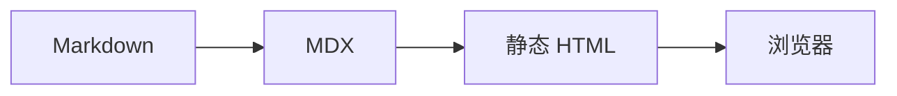

import Badge from '@sonder/mdx-components/Badge.astro';
import Blur from '@sonder/mdx-components/Blur.astro';
import CardList from '@sonder/mdx-components/CardList.astro';
import Carousel from '@sonder/mdx-components/Carousel.astro';
import Chat from '@sonder/mdx-components/Chat.astro';
import FriendCircle from '@sonder/mdx-components/FriendCircle.astro';
import FriendLinkApplication from '@sonder/mdx-components/FriendLinkApplication.astro';
import FriendLinkCard from '@sonder/mdx-components/FriendLinkCard.astro';
import Key from '@sonder/mdx-components/Key.astro';
import LinkCard from '@sonder/mdx-components/LinkCard.astro';
import LongImage from '@sonder/mdx-components/LongImage.astro';
import MediaShelf from '@sonder/mdx-components/MediaShelf.astro';
import MusicPlayer from '@sonder/mdx-components/MusicPlayer.astro';
import MusicScore from '@sonder/mdx-components/MusicScore.astro';
import NeteasePlaylist from '@sonder/mdx-components/NeteasePlaylist.astro';
import Poetry from '@sonder/mdx-components/Poetry.astro';
import Tab from '@sonder/mdx-components/Tab.astro';
import VideoEmbed from '@sonder/mdx-components/VideoEmbed.astro';
import ZoomableImage from '@sonder/mdx-components/ZoomableImage.astro';
import friendCircleDemo from '../../data/friend-circle-demo.json';
import coverApricot from '../../assets/figure/covers/cover-14-apricot.png';
import coverInk from '../../assets/figure/covers/cover-09-ink.png';
import coverLavender from '../../assets/figure/covers/cover-04-lavender.png';
import coverSage from '../../assets/figure/covers/cover-01-sage.png';
import coverTeal from '../../assets/figure/covers/cover-07-teal.png';

Sonder 目前提供二十个 MDX 内容组件。这篇速览把每一个都放进真实文章里跑一遍；
frontmatter 里也用到了模板扩展的 `postid` 与 `references` 字段（见文末参考链接）。

## 行内组件

### Badge 徽标

带图标与链接的行内徽标；不传 `img` 时会自动取 GitHub 头像或站点 favicon。

<Badge text="Astro" link="https://astro.build" />
<Badge text="GitHub" link="https://github.com/lmb666666/Sonder" />
<Badge text="纯文字徽标" />
<Badge img="https://github.com/lmb666666.png?size=64" text="带图圆形" link="https://github.com/lmb666666" />

### Key 按键

快捷键按键展示，macOS 自动切换为符号；在页面上真实按下对应组合键时，按键会亮起。

复制 <Key ctrl /> + <Key code="C" />；搜索 <Key cmd /> + <Key code="K" />；全选 <Key ctrl /> + <Key shift /> + <Key code="A" />

### Blur 剧透模糊

默认模糊，悬停、聚焦或按住时显形——剧透警告：<Blur text="他是凶手" />。

## 排版与结构

### Poetry 诗歌排版

<Poetry title="俳句一则" author="示例" footer="—— 匿名">
  {`旧博客沉去\n新模板在纸上醒来\n秋夜灯正明`}
</Poetry>

### Tab 选项卡

每个标签页的内容放进对应的 `tab1`、`tab2`… 命名插槽（MDX 中 Fragment 无需 import）：

<Tab tabs={['前端', '后端']}>
  <Fragment slot="tab1">
    
前端内容：Astro 静态生成，岛架构按需注水。

  </Fragment>
  <Fragment slot="tab2">
    
后端内容：纯静态输出，评论与动态走外部服务。

  </Fragment>
</Tab>

<Tab tabs={['一', '二', '三']} active={2} center>
  <Fragment slot="tab1">
    
第一页内容。

  </Fragment>
  <Fragment slot="tab2">
    
默认激活第二页（active=2）。

  </Fragment>
  <Fragment slot="tab3">
    
第三页内容。

  </Fragment>
</Tab>

### Chat 聊天记录

<Chat>
  {'{.我}'}
  
博客重写用什么模板？

  {'{朋友}'}
  
Sonder 收编完成，组件和内容都对齐了。

  {'{:对方撤回了一条消息并投来羡慕的目光}'}
  {'{.我}'}
  
那就这么定了。

</Chat>

### CardList 卡片列表

<CardList>

- Astro 静态生成
- Pagefind 中文搜索
- Twikoo 评论
- abcjs 乐谱

</CardList>

## 链接与社群

### LinkCard 链接卡片

<LinkCard
  link="https://github.com/lmb666666/Sonder"
  title="Sonder"
  description="以纸面阅读感为核心的个人发布模板"
  icon="https://github.com/lmb666666.png?size=64"
/>

### FriendLinkCard 友链卡片

友链以卡片网格排列；传入 `items`、`src` 或 `source` 都可以。这里复用了站点内置的演示友链数据：

<FriendLinkCard items={friendCircleDemo.friends.slice(0, 3)} columns={3} />

### FriendCircle 朋友圈

把友链的 RSS/Atom 动态聚合成时间线，右上角按钮可以重新洗牌。下面使用内置演示数据，不依赖外部订阅源：

<FriendCircle
  items={friendCircleDemo.friends}
  posts={friendCircleDemo.posts}
  limit={3}
  title="朋友动态"
/>

### FriendLinkApplication 友链申请

填写名称、主页、简介、头像和 RSS，实时生成友链 JSON；可以复制，也可以直接打开 GitHub Issue 申请。
下面以 Sonder 仓库为例：

<FriendLinkApplication
  repository="https://github.com/lmb666666/Sonder"
  title="申请友链"
  description="填写站点信息，预览后复制，或前往 GitHub 提交申请。"
  appearance="bordered"
/>

## 图像与媒体

### Carousel 轮播

轮播是一组横向滑动的幻灯片，左右按钮切换；每个子项加上 `data-carousel-slide` 即可：

<Carousel label="封面轮播" aspectRatio="16 / 9">
  <figure data-carousel-slide>
    
    <figcaption>Sonder 的纸面与鼠尾草色。</figcaption>
  </figure>
  <figure data-carousel-slide>
    
    <figcaption>紫藤色用于更安静的段落。</figcaption>
  </figure>
  <figure data-carousel-slide>
    
    <figcaption>杏色与暖纸的搭配。</figcaption>
  </figure>
</Carousel>

### LongImage 长图

长图放在固定高度的可滚动视口中，适合截图、长表格或纵向信息图：

<LongImage
  src={coverInk}
  alt="可滚动的长图示例"
  height="320px"
  caption="在视口内滚动查看完整图片；按 Tab 聚焦后也可以使用键盘滚动。"
/>

### ZoomableImage 图片放大

点击图片打开大图预览，支持关闭按钮和键盘操作。文章里的 Markdown 图片默认也会经过这个组件：

<ZoomableImage src={coverTeal} alt="点击放大的图片示例" />

### MediaShelf 媒体架

书、电影、剧集、专辑和播客共用一套货架。这里用本地封面演示四种类型：

<MediaShelf
  columns={4}
  items={[
    {
      title: 'Sonder 手记',
      creator: '示例作者',
      type: 'book',
      cover: coverSage,
      coverAspect: 'portrait',
      rating: 4,
      note: '一本关于纸面与留白的书。',
    },
    {
      title: '夜航',
      creator: '示例导演',
      type: 'film',
      cover: coverInk,
      coverAspect: 'portrait',
      rating: 5,
    },
    {
      title: '缓慢的下午',
      creator: '示例音乐人',
      type: 'album',
      cover: coverApricot,
      coverAspect: 'portrait',
      rating: 4,
    },
    {
      title: '城市观察',
      creator: '示例播客',
      type: 'podcast',
      cover: coverLavender,
      coverAspect: 'portrait',
    },
  ]}
/>

### VideoEmbed 视频嵌入

支持 raw / bilibili / bilibili-nano / youtube / douyin / douyin-wide / tiktok。
以下为 bilibili 示例：

<VideoEmbed type="bilibili" id="BV1GJ411x7h7" />

### MusicScore ABC 乐谱

ABC 记谱法乐谱；soundfonts 可达时可试听（音色库不可达时仅显示乐谱）：

<MusicScore
  abc={`X:1\nT:小星星\nM:4/4\nL:1/4\nK:C\n"1"C C G G|A A G2|"5"F F E E|D D C2|w: Twink-le twink-le lit-tle star, how I won-der what you are.`}
/>

### MusicPlayer 播放器

播放器支持原生音频/歌单，也支持 Spotify、SoundCloud、Bandcamp、Apple Music 和网易云的官方
embed。这里用 Spotify embed 演示，不新增本地音频文件：

<MusicPlayer
  title="示例曲目"
  artist="Spotify 示例"
  provider="spotify"
  url="https://open.spotify.com/track/4cOdK2wGLETKBW3PvgPWqT"
  size="wide"
/>

### NeteasePlaylist 网易云歌单

构建期经 Meting API 解析歌单后交给原生播放器（模板默认携带社区公共实例，
见 `site.toml` 的 `[config.music].meting_api`）：

<NeteasePlaylist id="7294439968" title="示例歌单" />

Meting 实例不可达或未配置时，同一个组件会自动降级为打开歌单的链接卡片。

## 图表

### Mermaid 图表

文章布局已经全局挂载 `MermaidRenderer`，正文里写 `mermaid` 代码块即可：

---

二十个组件到此看全。每个组件的属性说明见源码注释：`src/components/mdx/`。
